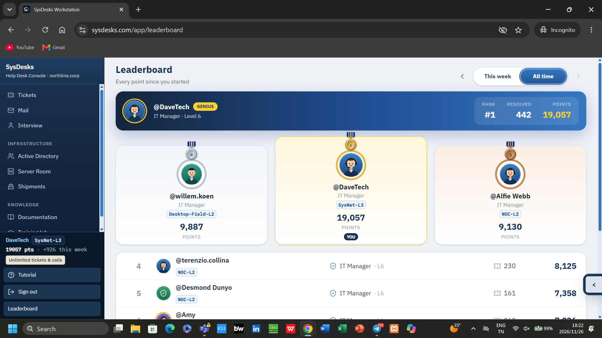
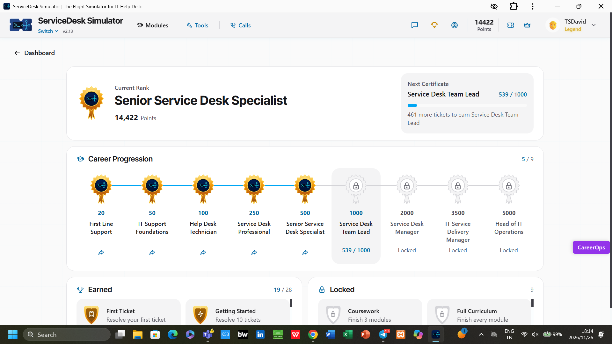

IT System Support, Field Tech, Service Desk portfolio (NQF 5) 900+ Resolved Tickets)
# 🛠️ IT Systems Support, Field Engineering & Service Desk Portfolio

**Candidate:** Tshegofatso Sephai  
**Location:** South Africa  
**Qualification:** National Certificate: IT (Systems Support) — NQF Level 5  
**Platform Handles:** `@DaveTech` (SysDesks.com) · `TSDavid` (ServiceDesk Simulator)  

## 👨‍💻 Professional Background & Summary
Hands-on **Systems Support & Field Engineering Technician** with **24 months of enterprise industry experience** across **NCR ATM South Africa (Pty) Ltd** (Customer Engineer Assistant Mentorship) and **Altron Digital Business / Impactful powered by KMLG** (Systems Support NQF 5 Learnership), backed by **981 resolved simulated help desk and network infrastructure tickets**.

Skilled in Tier 1/Tier 2 incident triage, on-site hardware and peripheral diagnostics, router and Layer 2/3 switch configuration (VLANs, trunking, port security), Active Directory administration, Windows 11 OS troubleshooting, and Microsoft 365 support.

## 🏢 Industry Experience & Accreditation
* **Customer Engineer Assistant (12-Month Mentorship Program)** — *NCR ATM South Africa (Pty) Ltd*
  * Performed on-site field diagnostics, preventive maintenance, hardware component replacements, and network connectivity troubleshooting on enterprise ATM systems under strict SLA timelines.
* **Systems Support Learner (12-Month Learnership)** — *Altron Digital Business & Impactful (powered by KMLG)*
  * Completed **Systems Support NQF Level 5** while delivering desktop support, Windows OS troubleshooting, Active Directory user administration, and structured IT service desk ticket resolution.

## 📊 Verified Simulation & Lab Volume (981 Tickets)

| Support Category | Tickets Resolved | Core Tools & Technologies |
| :--- | :--- | :--- |
| **Network Infrastructure & Switching** | ~280+ | Routers & Switches, VLANs, Trunk Ports, DHCP/DNS, VPN, `ping`, `tracert`, `nslookup` |
| **Identity & Access (AD / M365)** | ~280+ | Active Directory (ADUC), Password Resets, Account Lockouts, Security Groups |
| **Windows OS & Applications** | ~240+ | Windows 10/11, Outlook `.ost` Recovery, Print Spooler, NTFS Permissions |
| **Security & Escalations** | ~180+ | Port Security, Phishing Triage, MFA Resets, Endpoint Isolation, SLA Documentation |
| **Total Simulated Experience** | **981 Tickets** | **ServiceDesk Simulator (539) & SysDesks.com (442)** |

## 🏆 Platform Certifications & Career Milestones

| Platform | Credential / Rank | Verified Achievements |
| :--- | :--- | :--- |
| **SysDesks.com** | **IT Manager (Level 6) & SysNet-L3** | **6 of 9 Certificates Earned** · 50-Ticket Clean Streak · 64 Zero-Fault Tickets |
| **SysDesks.com** | **#1 All-Time Global Leaderboard** | Verified Profile `@DaveTech` · **19,057 Points** · 442 Tickets Resolved |
| **ServiceDesk Simulator** | **Senior Service Desk Specialist** | Verified Profile `TSDavid` · **14,422 Points** · 5/9 Career Milestones · 19/28 Badges |

## 📸 Verified Platform Dashboards

### SysDesks.com — #1 Global Leaderboard (442 Tickets)

### ServiceDesk Simulator — Senior Service Desk Specialist (539 Tickets)

## 🔍 Featured Troubleshooting Case Studies

### 1. Switch VLAN Misconfiguration & Trunk Port Isolation (SysNet-L3)
* **Category:** Network Infrastructure & Switching (Tier 2)
* **Issue:** Entire Accounting department lost access to the local file server and internet after a switch port maintenance change, receiving APIPA (`169.254.x.x`) addresses.
* **Diagnostics:**
  1. Verified workstations were failing to reach the DHCP server across the distribution switch.
  2. Consoled into the access switch and inspected interface status (`show interfaces status` and `show vlan brief`), discovering the uplink port was set to `access` mode instead of `trunk` mode and client ports were assigned to the default `VLAN 1` instead of `VLAN 20 (Accounting)`.
  3. Checked the router sub-interface (`Gi0/0.20`) to verify inter-VLAN routing and DHCP relay (`ip helper-address`) were operational.
* **Resolution:** Configured the uplink interface as an 802.1Q trunk allowing `VLAN 20`, reassigned user ports to `switchport access vlan 20`, ran `ipconfig /release` and `ipconfig /renew` on affected endpoints, and confirmed full gateway and server connectivity.

### 2. Router Default Gateway & DNS Resolution Failure
* **Category:** Routing & Network Connectivity
* **Issue:** Branch office workstation reported “No Internet Access” despite an active Ethernet link to the floor switch.
* **Diagnostics:**
  1. Ran `ipconfig /all` and verified a valid IPv4 lease (`10.10.20.45`) and default gateway (`10.10.20.1`).
  2. Pinged the router gateway (`10.10.20.1`) and external IP (`8.8.8.8`) with 0% packet loss, confirming Layer 3 routing was healthy.
  3. Ran `nslookup google.com` which timed out, isolating the failure to DNS resolution rather than router packet forwarding.
  4. Discovered a misconfigured static DNS entry pointing to a decommissioned server.
* **Resolution:** Switched IPv4 DNS settings back to automatic (DHCP), ran `ipconfig /flushdns` and `ipconfig /registerdns`, and verified full external and internal name resolution.

### 3. Active Directory Account Lockout & Group Policy Sync
* **Category:** Identity & Access Management
* **Issue:** Remote user unable to sign into Windows 11 laptop after a password reset (*”The referenced account is currently locked out”*).
* **Diagnostics:**
  1. Verified the locked status in **Active Directory Users and Computers (ADUC)**.
  2. Checked Domain Controller Security Logs (**Event ID 4740**) to trace the lockout source.
  3. Found cached outdated credentials on the user’s mobile Outlook app repeatedly failing authentication.
* **Resolution:** Guided the user to update their mobile mail password first, unlocked the AD account, connected VPN, and ran `gpupdate /force` to sync credentials.

### 4. Shared Network Drive “Access Denied” (NTFS & Share Permissions)
* **Category:** File Services & Access Control
* **Issue:** New Finance hire received *”Access is Denied”* when opening `S:\Finance_Reports`.
* **Diagnostics:**
  1. Checked user group memberships via PowerShell (`Get-ADPrincipalGroupMembership`).
  2. Found the user was missing from the `SG_Finance_ReadWrite` security group.
* **Resolution:** Added the user to `SG_Finance_ReadWrite` in ADUC, had them refresh their Kerberos ticket (`klist purge` / re-login), and verified least-privilege access.

### 5. Microsoft 365 Outlook Profile Corruption & Print Spooler Hang
* **Category:** M365 Applications & Endpoint Diagnostics
* **Issue:** Workstation experiencing Outlook desktop profile hang (*”Loading Profile”*) alongside high CPU utilization from stalled print jobs.
* **Diagnostics:**
  1. Verified mailbox health via Outlook on the Web (OWA) and identified a corrupted local `.ost` file in `%localappdata%\Microsoft\Outlook`.
  2. Checked Task Manager and found `spoolsv.exe` consuming 85% CPU due to a stuck `.spl` file in `C:\Windows\System32\spool\PRINTERS`.
* **Resolution:** Rebuilt the Outlook profile via **Control Panel > Mail > Show Profiles**, terminated `spoolsv.exe`, cleared the `PRINTERS` spool directory, restarted the service, and confirmed normal workstation performance.

